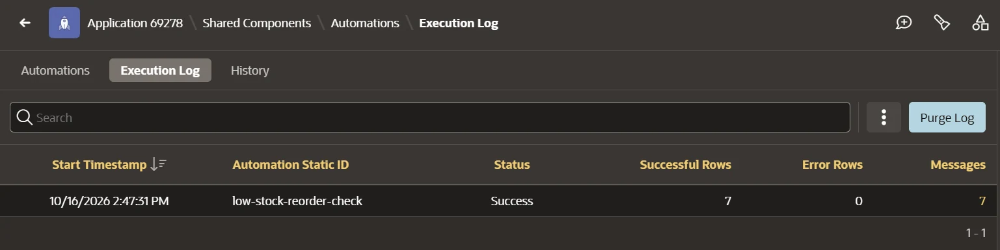
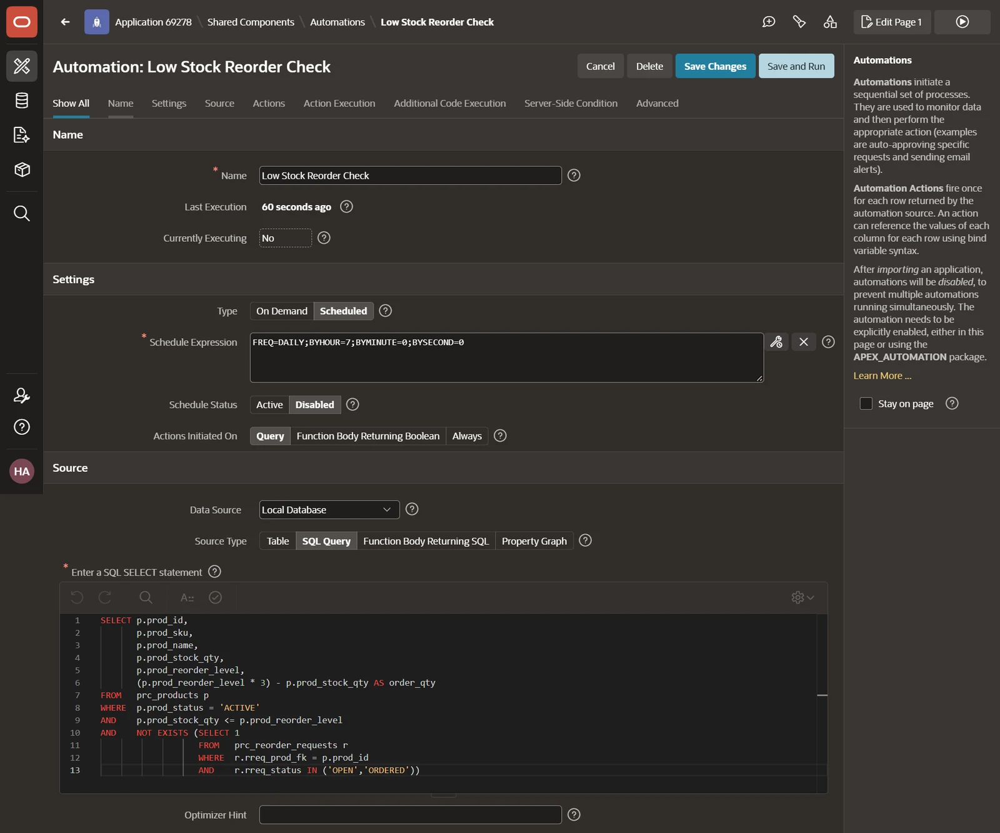
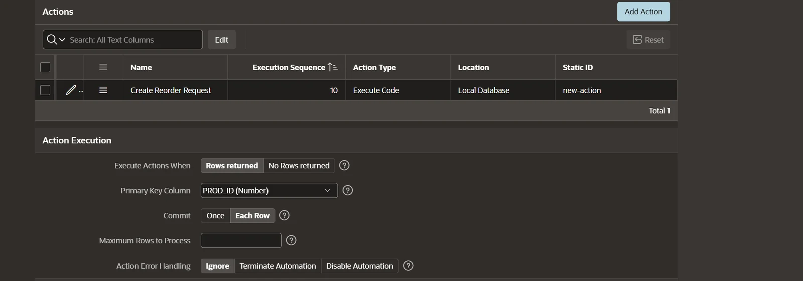
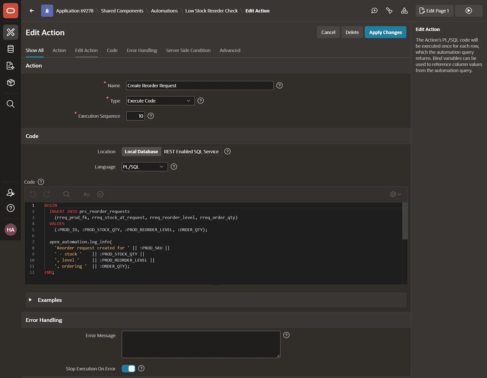
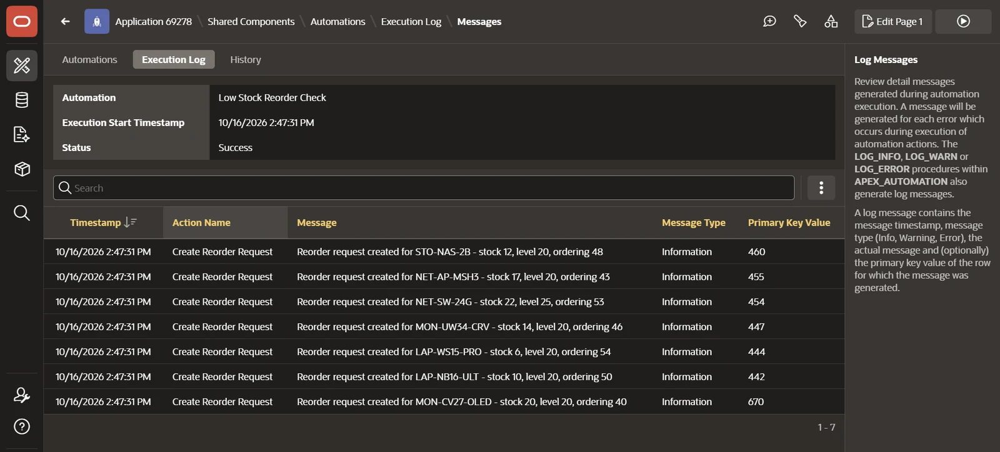
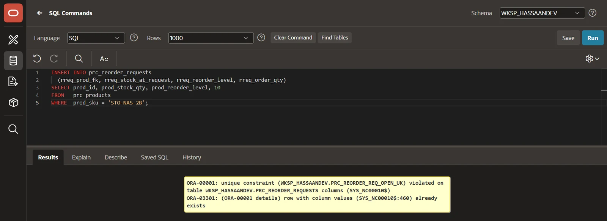
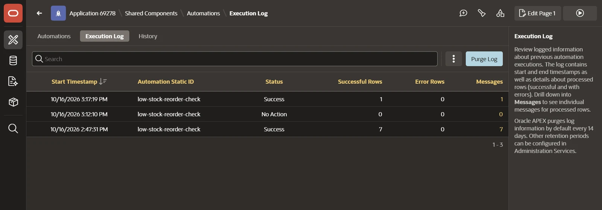
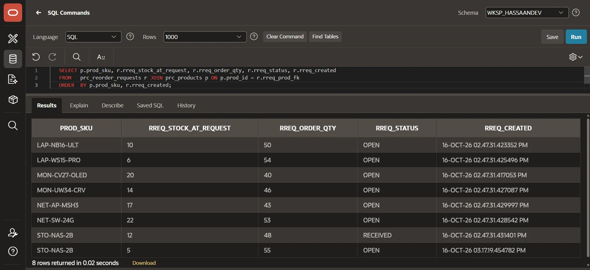
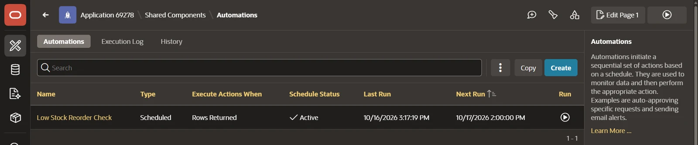

# Oracle APEX Automations — Build a Self-Running Low-Stock Reorder Job with Logging and No Duplicates

[](LICENSE)


> Build a scheduled Oracle APEX Automation that finds low-stock products every evening, creates reorder requests, logs every row and can never create a duplicate.

<p align="center">
  
</p>

**By Hassaan Ahmed Tahir — Senior Oracle APEX Developer · [Read the full tutorial](https://apexwithhassaan.vercel.app/blog/automations-low-stock-reorder)**

---

## 📁 Repository structure

```
apex-automations-low-stock-reorder/
src/01_prepare_database.sql           # reorder level column, PRC_REORDER_REQUESTS table, safety-net index
src/02_automation_source_query.sql    # automation source query (products below reorder level)
src/03_automation_action.sql          # automation action (creates the reorder request)
docs/images/                          # screenshots from the blog post
CHANGELOG.md
LICENSE                               # MIT
README.md
```

> 💡 Every file above contains the exact code from the tutorial below, ready to copy or run.

---

Every business application has jobs that should happen *without anyone clicking a button*: send a reminder when an invoice is overdue, close requests nobody touched for 30 days, warn the team when a contract is about to expire — or, in this post, **reorder products before they run out**.

The classic answer is a `DBMS_SCHEDULER` job plus a PL/SQL package that loops over rows, handles errors and writes its own log table. It works, but it lives outside your application, it's invisible to most of the team, and it doesn't travel with your APEX export. **Automations** give you the same power declaratively, from **Shared Components**: a query finds the work, actions do the work, and a built-in log proves it happened.

This is **part two** of a small series. In the [Data Load Definitions post](https://apexwithhassaan.vercel.app/blog/data-load-definitions) we built a product catalog that users update by uploading Excel price lists. Now we let APEX **watch that catalog every day** and create reorder requests for products that are running low — safely, with full logging and without ever creating a duplicate.

> ✅ **What you'll have at the end:** a scheduled automation that runs every evening, finds every active product at or below its reorder level, creates exactly one reorder request per product, writes a readable log line for each, and can be run again any number of times without side effects.

> 🧪 **Tested on:** Oracle APEX 26.2 with Oracle Database 23.0. Automations have been part of Shared Components since APEX 20.2; screen labels can differ slightly between versions.

## 📑 Table of Contents

1. [What Is an APEX Automation?](#what-is)
2. [Anatomy of an Automation](#anatomy)
3. [How Automations Fit with Data Load Definitions](#with-data-load)
4. [The Scenario: Low-Stock Reorder Requests](#scenario)
5. [Step 1: Prepare the Database](#step-1)
6. [Step 2: Create the Automation](#step-2)
7. [Step 3: Configure Action Execution](#step-3)
8. [Step 4: Add the Action](#step-4)
9. [Step 5: First Run and the Execution Log](#step-5)
10. [Step 6: Prove It's Safe to Run Again](#step-6)
11. [Step 7: Go Live — Schedule, Time Zone and Activation](#step-7)
12. [Gotchas and Tips](#gotchas)
13. [More Jobs You Can Automate the Same Way](#ideas)
14. [Production Checklist](#checklist)
15. [Wrap-Up](#wrap-up)

<a id="what-is"></a>

## 1. What Is an APEX Automation?

An **Automation** is a background job defined in **Shared Components → Automations**. APEX runs it for you — on a schedule, or when your code asks — with no user and no page involved.

The idea fits in one sentence: **a query finds the work, the actions do the work, and the log proves it happened.**

|  | DBMS_SCHEDULER job + package | APEX Automation |
|---|---|---|
| Where it lives | In the database, outside the app | In Shared Components, inside the app |
| Looping over rows | You write the cursor loop | Automatic — actions run once per query row |
| Row values in your code | Fetched into variables | Bind variables named after the query columns (`:PROD_ID`) |
| Error handling per row | Your own exception blocks | One setting: Ignore, Terminate or Disable |
| Logging | Your own log table | Built-in **Execution Log** + `apex_automation.log_info` |
| Deployment | Separate scripts | Exported and imported with the application |

<a id="anatomy"></a>

## 2. Anatomy of an Automation

Every automation is built from the same pieces. Once you know them, every automation screen makes sense:

| Piece | What it decides | Options you'll see |
|---|---|---|
| **Type** | When it runs | *Scheduled* (a timer) or *On Demand* (only when called from code) |
| **Schedule Expression** | The timing | Scheduler syntax such as `FREQ=DAILY;BYHOUR=14;BYMINUTE=0` — there's a builder icon next to the field |
| **Schedule Status** | Whether the timer is switched on | *Active* or *Disabled* |
| **Actions Initiated On** | What drives the actions | *Query* (once per row), *Function Body Returning Boolean*, or *Always* (once per run) |
| **Source** | Which rows to work on | Table, SQL Query, Function Body Returning SQL (or Property Graph) — from the local database or another data source |
| **Actions** | What to do with each row | Executed in sequence, e.g. *Execute Code* (PL/SQL) |
| **Action Execution** | How rows are processed | Primary Key Column, Commit *Once* or *Each Row*, Action Error Handling *Ignore / Terminate / Disable* |
| **Execution Log** | The history | Every run with status, successful rows, error rows and messages |

<a id="with-data-load"></a>

## 3. How Automations Fit with Data Load Definitions

Think of a warehouse:

- **The Data Load Definition is the front door.** Goods — data — come in when a *person* uploads a file. It acts **once, at the moment of upload**.
- **The Automation is the night-shift worker.** Nobody calls them. Every day they walk the warehouse with a checklist, look at what's there **now**, and act on it.

1. 📄 **Price list upload** — Data Load Definition — a user, any time
2. 🗄️ **PRC_PRODUCTS** — Stock levels change
3. ⏰ **Automation** — Every evening — nobody clicks
4. 🛒 **Reorder requests** — Ready for purchasing, fully logged

|  | Data Load Definition | Automation |
|---|---|---|
| Started by | A user uploading a file | A schedule (or your code) |
| Works on | The rows in the file | The rows a query finds in your tables |
| When | Once, at upload time | Repeatedly — e.g. every day |
| Result | Rows loaded + list of rejected rows | Actions per row + Execution Log |
| In this series | Brings the price list into `PRC_PRODUCTS` | Watches `PRC_PRODUCTS` and creates reorder requests |

**The benefits, in plain words:**

- **Nobody has to remember** — the check runs every day, holidays included.
- **The same rule every time** — no human judgement, no forgotten product.
- **Safe to repeat** — running it twice, or by accident, never creates duplicates.
- **A built-in audit trail** — when it ran, how many rows, and what happened to each one.
- **One bad row doesn't stop the rest** — each product is handled on its own.
- **No scheduler code to maintain** — and it ships with the application export.

<a id="scenario"></a>

## 4. The Scenario: Low-Stock Reorder Requests

We continue with the `PRC_` tables from the previous post: `PRC_PRODUCTS` holds the catalog with a `prod_stock_qty` column that changes with every price-list upload.

**The business rule:**

- Every product has a **reorder level** (default 20).
- When an **active** product's stock is **at or below** that level, create a reorder request.
- Order enough to bring stock back up to **three times** the reorder level: `order qty = level × 3 − stock`.
- Never create a second request while one is still **OPEN** or **ORDERED** for that product.
- **Discontinued** products are never reordered, however low their stock.

<a id="step-1"></a>

## 5. Step 1: Prepare the Database

Run this in **SQL Workshop → SQL Scripts**. It adds the reorder level, creates the table the automation writes to, and adds a database-level safety net.

```sql
-- 1. Reorder level per product (existing rows get 20)
ALTER TABLE prc_products ADD (
  prod_reorder_level NUMBER(10) DEFAULT 20 NOT NULL,
  CONSTRAINT prc_products_reord_ck CHECK (prod_reorder_level >= 0)
);

-- Levels can differ per product
UPDATE prc_products SET prod_reorder_level = 25 WHERE prod_sku = 'NET-SW-24G';
COMMIT;
```

```sql
CREATE TABLE prc_reorder_requests (
  rreq_id               NUMBER GENERATED BY DEFAULT AS IDENTITY,
  rreq_prod_fk          NUMBER        NOT NULL,
  rreq_stock_at_request NUMBER(10)    NOT NULL,
  rreq_reorder_level    NUMBER(10)    NOT NULL,
  rreq_order_qty        NUMBER(10)    NOT NULL,
  rreq_status           VARCHAR2(20)  DEFAULT 'OPEN' NOT NULL,
  rreq_created          TIMESTAMP     DEFAULT SYSTIMESTAMP NOT NULL,
  rreq_created_by       VARCHAR2(4000)
                        DEFAULT COALESCE(SYS_CONTEXT('apex$session','app_user'),
                                         SYS_CONTEXT('userenv','session_user')) NOT NULL,
  rreq_closed           TIMESTAMP,
  CONSTRAINT prc_reorder_req_pk      PRIMARY KEY (rreq_id),
  CONSTRAINT prc_reorder_req_prod_fk FOREIGN KEY (rreq_prod_fk) REFERENCES prc_products (prod_id),
  CONSTRAINT prc_reorder_req_qty_ck  CHECK (rreq_order_qty > 0),
  CONSTRAINT prc_reorder_req_stat_ck CHECK (rreq_status IN ('OPEN','ORDERED','RECEIVED','CANCELLED'))
);

CREATE INDEX prc_reorder_req_prod_ix ON prc_reorder_requests (rreq_prod_fk);
```

```sql
-- Safety net: at most ONE active (OPEN or ORDERED) request per product
CREATE UNIQUE INDEX prc_reorder_req_open_uk ON prc_reorder_requests (
  CASE WHEN rreq_status IN ('OPEN','ORDERED') THEN rreq_prod_fk END
);
```

This index is the clever part. It only stores a value while a request is `OPEN` or `ORDERED`; for `RECEIVED` and `CANCELLED` rows the expression is `NULL`, and Oracle doesn't index NULLs. The result: **one active request per product**, while closed requests remain as unlimited history.

> 💡 **Why two layers?** The automation's query will already skip products that have an active request. The index makes it impossible *anyway* — even if someone changes the query, runs a manual insert, or two runs overlap. Rules that must never break belong in the database.

Before building anything, preview what the automation will find. This is exactly the query we'll use as its source:

```sql
SELECT p.prod_id,
       p.prod_sku,
       p.prod_name,
       p.prod_stock_qty,
       p.prod_reorder_level,
       (p.prod_reorder_level * 3) - p.prod_stock_qty AS order_qty
FROM   prc_products p
WHERE  p.prod_status = 'ACTIVE'
AND    p.prod_stock_qty <= p.prod_reorder_level
AND    NOT EXISTS (SELECT 1
                   FROM   prc_reorder_requests r
                   WHERE  r.rreq_prod_fk = p.prod_id
                   AND    r.rreq_status IN ('OPEN','ORDERED'))
ORDER  BY p.prod_sku;
```

After the February price list from the previous post, it returns **7 products**:

| Article No. | Stock | Reorder level | Order qty |
|---|---|---|---|
| LAP-NB16-ULT | 10 | 20 | 50 |
| LAP-WS15-PRO | 6 | 20 | 54 |
| MON-CV27-OLED | 20 | 20 | 40 |
| MON-UW34-CRV | 14 | 20 | 46 |
| NET-AP-MSH3 | 17 | 20 | 43 |
| NET-SW-24G | 22 | **25** | 53 |
| STO-NAS-2B | 12 | 20 | 48 |

Two rows prove the rules work: `NET-SW-24G` appears only because of its custom level of 25, and `MON-PF24-FHD` — stock **0** — is **absent**, because the February file marked it `DISCONTINUED`.

<a id="step-2"></a>

## 6. Step 2: Create the Automation

Go to **Shared Components → Automations → Create** and use these settings:

| Setting | Value | Why |
|---|---|---|
| Name | `Low Stock Reorder Check` | Static ID becomes `low-stock-reorder-check` |
| Type | **Scheduled** | Runs on a timer |
| Schedule Expression | `FREQ=DAILY;BYHOUR=14;BYMINUTE=0;BYSECOND=0` | Daily — see Step 7 for why 14 means 7 PM in Pakistan |
| Schedule Status | **Disabled** (for now) | No surprise run while we're still building |
| Actions Initiated On | **Query** | Actions run once for every row the query returns |
| Data Source / Source Type | Local Database / **SQL Query** |  |
| SQL Query | The preview query above (without `ORDER BY`) | Its columns become the bind variables in Step 4 |

<p align="center">
  <br>
  <em>Figure 1 · Automation — Settings and Source. The automation while it was being tested: Scheduled, temporarily Disabled, actions initiated on Query, and the low-stock query as its source. (The schedule still says BYHOUR=7 here — we fix the time in Step 7.)</em>
</p>

> ℹ️ **Disabled doesn't mean "can't run".** The status only controls the *timer*. **Save and Run** on the edit page and the ▶ button in the Automations list still run it manually — that's exactly how we test it below.

<a id="step-3"></a>

## 7. Step 3: Configure Action Execution

The **Action Execution** section decides how the rows are processed. The defaults are not ideal for this job, so change three of them:

| Setting | Default | Our value | Why |
|---|---|---|---|
| Execute Actions When | Rows returned | Rows returned | Nothing to do when nothing is low |
| Primary Key Column | – Select – | **PROD_ID** | Each log message is tagged with the product's ID |
| Commit | Once | **Each Row** | Every request is saved on its own; one failure can't roll back the others |
| Action Error Handling | Terminate Automation | **Ignore** | A failing product is logged as an error row and the run continues |

<p align="center">
  <br>
  <em>Figure 2 · Action Execution. Primary Key Column PROD_ID, Commit Each Row, Action Error Handling Ignore.</em>
</p>

The same page also has an **Additional Code Execution** section — an initialization procedure, a before-row procedure and a cleanup procedure. We don't need them here, but they're handy for things like setting up a context once per run.

<a id="step-4"></a>

## 8. Step 4: Add the Action

The wizard creates a placeholder action. Edit it: name **Create Reorder Request**, type **Execute Code**, location **Local Database**, language **PL/SQL**:

```sql
BEGIN
  INSERT INTO prc_reorder_requests
    (rreq_prod_fk, rreq_stock_at_request, rreq_reorder_level, rreq_order_qty)
  VALUES
    (:PROD_ID, :PROD_STOCK_QTY, :PROD_REORDER_LEVEL, :ORDER_QTY);

  apex_automation.log_info(
    'Reorder request created for ' || :PROD_SKU ||
    ' - stock '    || :PROD_STOCK_QTY ||
    ', level '     || :PROD_REORDER_LEVEL ||
    ', ordering '  || :ORDER_QTY);
END;
```

Two things to notice:

- **No loop.** APEX runs this block once per query row and binds each column by name — `:PROD_ID`, `:PROD_SKU`, `:ORDER_QTY` come straight from the source query's column aliases.
- **`apex_automation.log_info`** writes a readable line into the Execution Log. `log_warn` and `log_error` work the same way for other message types.

<p align="center">
  <br>
  <em>Figure 3 · Edit Action — Execute Code. The action's PL/SQL. Column values from the source query arrive as bind variables.</em>
</p>

<a id="step-5"></a>

## 9. Step 5: First Run and the Execution Log

Click **Save and Run**. Then open **Shared Components → Automations → Execution Log**:

<p align="center">
  <br>
  <em>Figure 4 · Execution Log — first run. Success — 7 successful rows, 0 error rows, 7 messages.</em>
</p>

The yellow number in the **Messages** column is a link. Click it to drill into the run:

<p align="center">
  <br>
  <em>Figure 5 · Execution Log — messages of the first run. One log_info line per product, tagged with the action name and — thanks to the Primary Key Column setting — the product's ID.</em>
</p>

And the data itself:

```sql
SELECT p.prod_sku,
       r.rreq_stock_at_request,
       r.rreq_reorder_level,
       r.rreq_order_qty,
       r.rreq_status,
       r.rreq_created
FROM   prc_reorder_requests r
JOIN   prc_products p ON p.prod_id = r.rreq_prod_fk
ORDER  BY p.prod_sku, r.rreq_created;
```

| Article No. | Stock | Level | Order qty | Status |
|---|---|---|---|---|
| LAP-NB16-ULT | 10 | 20 | 50 | **OPEN** |
| LAP-WS15-PRO | 6 | 20 | 54 | **OPEN** |
| MON-CV27-OLED | 20 | 20 | 40 | **OPEN** |
| MON-UW34-CRV | 14 | 20 | 46 | **OPEN** |
| NET-AP-MSH3 | 17 | 20 | 43 | **OPEN** |
| NET-SW-24G | 22 | 25 | 53 | **OPEN** |
| STO-NAS-2B | 12 | 20 | 48 | **OPEN** |

> ✅ **Seven requests, seven log lines** — the exact rows and quantities the preview query predicted.

<a id="step-6"></a>

## 10. Step 6: Prove It's Safe to Run Again

A job that runs every day must be **idempotent**: running it again must not change anything unless the data changed. Three tests prove it.

### Test A — run it again immediately

Click **Save and Run** a second time. Every low-stock product already has an `OPEN` request, so the query returns nothing. The log shows the run with status **No Action** and 0 rows (you'll see it in Figure 7 below), and the table still has 7 requests.

### Test B — try to cheat the safety net

Simulate a bug or a second process by inserting a duplicate request by hand:

```sql
INSERT INTO prc_reorder_requests
  (rreq_prod_fk, rreq_stock_at_request, rreq_reorder_level, rreq_order_qty)
SELECT prod_id, prod_stock_qty, prod_reorder_level, 10
FROM   prc_products
WHERE  prod_sku = 'STO-NAS-2B';
```

<p align="center">
  <br>
  <em>Figure 6 · The unique index rejects a duplicate. ORA-00001: unique constraint (…PRC_REORDER_REQ_OPEN_UK) violated — the database refuses a second active request for the same product.</em>
</p>

### Test C — the full life cycle

The goods for `STO-NAS-2B` arrive, the request is closed — and later the stock runs low again:

```sql
-- goods arrive: close the request
UPDATE prc_reorder_requests
SET    rreq_status = 'RECEIVED',
       rreq_closed = SYSTIMESTAMP
WHERE  rreq_prod_fk = (SELECT prod_id FROM prc_products WHERE prod_sku = 'STO-NAS-2B')
AND    rreq_status  = 'OPEN';

-- later: sold out again
UPDATE prc_products SET prod_stock_qty = 5 WHERE prod_sku = 'STO-NAS-2B';
COMMIT;
```

Run the automation once more. It finds exactly one product and creates exactly one new request:

<p align="center">
  <br>
  <em>Figure 7 · Execution Log — three runs. First run: Success, 7 rows. Second run: No Action. Third run, after the goods arrived and stock dropped again: Success, 1 row.</em>
</p>

<p align="center">
  <br>
  <em>Figure 8 · Reorder requests after all tests. 8 requests. STO-NAS-2B appears twice: the closed RECEIVED request (stock 12, ordered 48) and a new OPEN one (stock 5, ordered 55).</em>
</p>

| Test | What we did | Result |
|---|---|---|
| A | Ran it twice in a row | Second run: **No Action** — no duplicates |
| B | Inserted a duplicate by hand | `ORA-00001` — blocked by the database |
| C | Closed a request, stock dropped again | Exactly **1** new request; history kept **RECEIVED** |

<a id="step-7"></a>

## 11. Step 7: Go Live — Schedule, Time Zone and Activation

### The time-zone trap

Look at the timestamps in the Execution Log: the first run shows **2:47 PM**, although I clicked *Save and Run* at **7:47 PM** Pakistan time. The database server runs on **UTC**, and the schedule expression is interpreted in the server's time, not yours.

| I want it to run at… | Pakistan (UTC+5) | Schedule expression |
|---|---|---|
| 7:00 AM local | 07:00 PKT = 02:00 UTC | `FREQ=DAILY;BYHOUR=2;BYMINUTE=0;BYSECOND=0` |
| 7:00 PM local | 19:00 PKT = 14:00 UTC | `FREQ=DAILY;BYHOUR=14;BYMINUTE=0;BYSECOND=0` |

> ⚠️ **Check your server's clock first.** Run an automation once manually and compare the Execution Log time with your own clock. The difference is the offset you need to apply to `BYHOUR`.

### Switch it on

Set **Schedule Status** to **Active** with the expression for 7 PM Pakistan time, and save. The Automations list now shows when it will run next:

<p align="center">
  <br>
  <em>Figure 9 · Automations — Active, with the next run scheduled. Active, last run 3:17 PM, next run 2:00 PM UTC — 7:00 PM in Pakistan.</em>
</p>

> ✅ **Done.** From now on, every evening APEX checks the catalog, creates the requests that are needed, skips everything that's already handled, and writes it all to the log — with nobody clicking a button.

<a id="gotchas"></a>

## 12. Gotchas and Tips

| Topic | What to know |
|---|---|
| 🕑 **Server time** | The schedule follows the database server's time zone — often UTC. Convert your local time before setting `BYHOUR`. |
| 📦 **After an import** | Imported applications bring their automations in **disabled**, so a deployment never starts jobs by surprise. Remember to activate them in each environment. |
| 🧾 **Log retention** | APEX purges the Execution Log after **14 days** by default (configurable in Administration Services). If you need a permanent history, keep it in your own table — like `PRC_REORDER_REQUESTS` here. |
| 🔁 **Idempotency** | Your source query must exclude rows that were already handled, or every run repeats the work. Back it with a constraint if duplicates would be harmful. |
| 📌 **"In progress" states** | My first version only excluded `OPEN` requests. But once purchasing sets a request to `ORDERED`, stock stays low until the goods arrive — the next run would order again. Treat every in-progress status as "already handled". |
| 🏷️ **Bind names** | Bind variables in actions match the source query's **column aliases**. Rename a column in the query and you must rename the bind in the action. |
| ▶️ **Testing** | Keep the schedule *Disabled* while building; **Save and Run** still works. |

<a id="ideas"></a>

## 13. More Jobs You Can Automate the Same Way

The pattern — *query finds the work, action does it, log proves it* — fits a surprising number of everyday jobs:

| Job | Source query finds… | Action does… |
|---|---|---|
| Overdue invoices | Unpaid invoices past their due date, not yet reminded | Create a reminder record, log it |
| Expiring contracts | Contracts ending in the next 30 days | Flag them and notify the owner |
| Stale requests | Requests untouched for 30 days | Close them with a reason |
| Auto-approval | Small requests below an amount limit | Approve and record who/what approved |
| Housekeeping | Staging or temporary rows older than N days | Delete them and log the count |

<a id="checklist"></a>

## 14. Production Checklist

| ✔ | Practice | Why |
|---|---|---|
| 🧪 | **Build with the schedule Disabled**, test with Save and Run | No half-finished job runs overnight |
| 🔍 | **Preview the source query in SQL Commands** first | You know exactly which rows the actions will touch |
| 🔁 | **Make it idempotent** — exclude handled rows and add a unique constraint | Re-runs and overlaps can't create duplicates |
| 🔑 | **Set the Primary Key Column** | Every log message points to the exact row |
| 💾 | **Commit Each Row + Ignore** for independent rows | One bad row doesn't block or roll back the rest |
| 📝 | **Log with `apex_automation.log_info`** | The Execution Log tells you what happened, not just that it ran |
| 📦 | **Keep actions short** — call a package procedure for real logic | Easier to test and reuse outside the automation |
| 🕑 | **Convert schedules to server time** | Avoid jobs firing hours too early or late |
| 👀 | **Check the Execution Log** after go-live — especially *Error Rows* | Silent failures are the dangerous ones |

<a id="wrap-up"></a>

## 15. Wrap-Up

With one table, one unique index, one query and twelve lines of PL/SQL, we built a job that runs itself:

- A **scheduled automation** in Shared Components — no `DBMS_SCHEDULER` code.
- **Actions initiated on a query** with column values as bind variables — no loops.
- **Commit Each Row** and **Ignore** so every product is handled independently.
- A readable trail in the **Execution Log** with `apex_automation.log_info`.
- **Idempotency** proven three ways: a re-run, a blocked duplicate, and a full request life cycle.

Together with the previous post, the catalog now has a complete loop: users **bring data in** with a Data Load Definition, and an Automation **keeps watching it** and acts on it every day.

> 💡 **Try this next:** switch the Type to *On Demand* on a copy of this automation and call it right after the price-list upload — so stock is checked the moment new data arrives instead of waiting for the evening run.

---

## 📝 Changelog

See [CHANGELOG.md](CHANGELOG.md) for the version history.

---

## 📄 License

Released under the [MIT License](LICENSE) — free to use, modify and redistribute in personal and commercial projects.

---

## 🙏 Credits

Built by **Hassaan Ahmed Tahir** — Senior Oracle APEX Developer.
Special thanks to **Sajjad Hanifa** for his continued guidance and support in exploring and refining these Oracle APEX techniques.

📌 Read the original write-up on **[APEX with Hassaan](https://apexwithhassaan.vercel.app/blog/automations-low-stock-reorder)**, and keep an eye on the blog for more Oracle APEX tutorials.
